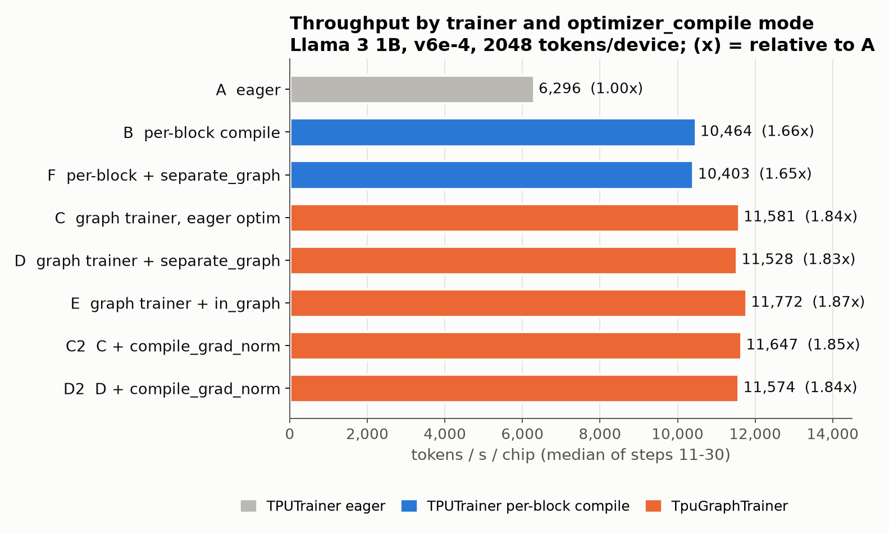
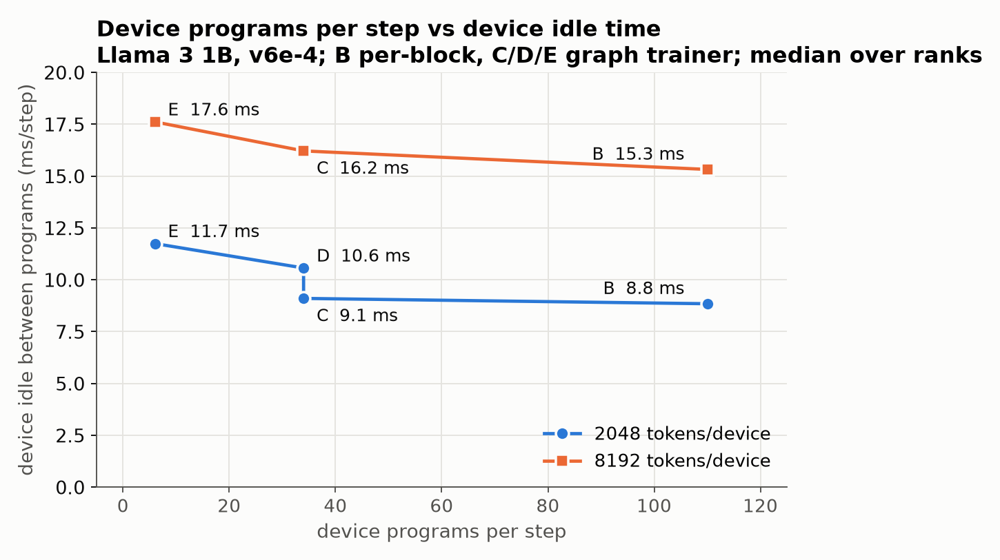
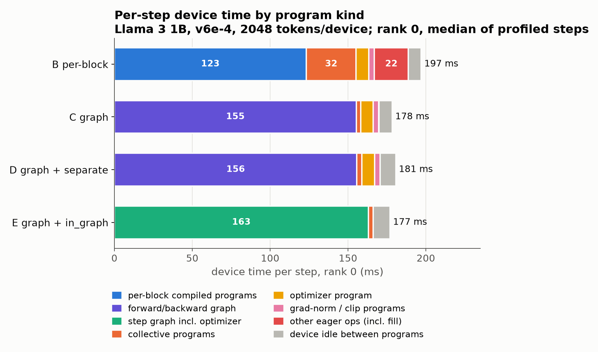
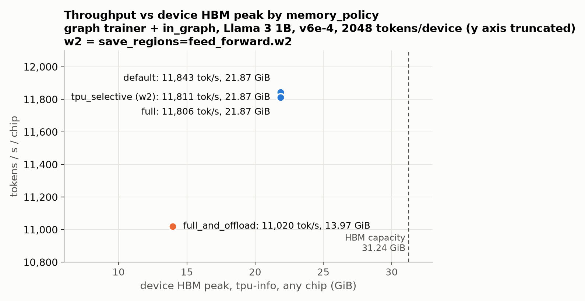
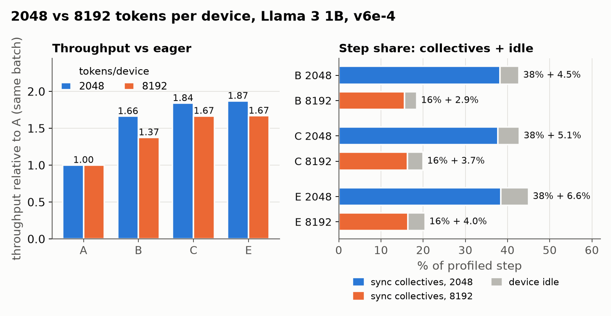

# torch-tpu-graphtrainer-xprof

Where the TorchTitan `TpuGraphTrainer` speedup on TPU comes from, measured with
timed runs and profiler traces. This follows up
[`torch-tpu-graphtrainer-ladder`](../torch-tpu-graphtrainer-ladder/), which
reported 2.06x over eager with the optimizer in the step graph but did not
measure why.

What was measured:

- Eight optimizer-compilation configurations on Llama 3 1B (TPU v6e-4): eager,
  per-block `torch.compile`, and `TpuGraphTrainer` with
  `optimizer_compile` = `eager`, `separate_graph` or `in_graph`, plus
  `compile_grad_norm=True` variants.
- Profiles (TorchTitan built-in profiler, XProf `.xplane.pb` plus Chrome-trace
  JSON) of four of them: device programs per step, device idle time between
  programs, collective time, host blocking.
- The logged memory figure against device HBM (`tpu-info` sampling and the
  XProf memory profile), four `memory_policy` values, and 8192 tokens per
  device.
- A re-run of the earlier ladder's TorchTitan commit `89ef29b` in the same
  environment.
- Llama 3 8B on TPU v6e-8.

The full results, each separated into what was observed and what is inferred,
are in [`docs/findings.md`](docs/findings.md).

## Environment

| Item | Value |
|---|---|
| Hardware, 1B | Cloud TPU v6e-4 (four chips) |
| Hardware, 8B | Cloud TPU v6e-8 (eight chips), Spot |
| Runtime image | `v2-alpha-tpuv6e` |
| Python | 3.14.10 (installed with `uv`; the VM image ships 3.10) |
| torch | 2.15.0+cpu |
| torch_tpu | 0.2.0 |
| libtpu | 0.0.50 |
| TorchTitan | `google-pytorch/torchtitan` @ `e78271f70ed1490499ab4feda157e23cc908c9d7` |
| TorchTitan, old-commit re-run | @ `89ef29b5a0d03a6883079ab37ff1bdc498fe3485` |
| numpy | 2.5.5 |
| transformers | 5.24.0 (first day), 5.24.1 (later runs) |
| HBM per chip | 31.24 GiB (as reported by `tpu-info` and XProf) |

`results/versions.json` is the record written by `setup.sh` on the first VM.
The `torch_tpu` and `xprof` modules expose no `__version__`; the `torch_tpu`
version above is from `pip freeze`. Model: TorchTitan `llama3_1b` with weight
tying disabled (see `scripts/bench_cfg.py`), sequence length 2048, FSDP via
`--parallelism.use_simple_fsdp`, 30 steps, median of steps 11-30.

## Headline results

Llama 3 1B, v6e-4, 2048 tokens per device, tokens/s/chip:

| ID | Configuration | tok/s/chip | vs A | Programs/step | Device idle (ms/step) |
|---|---|---:|---:|---:|---:|
| A | TPUTrainer, eager | 6,296 | 1.00x | - | - |
| B | TPUTrainer, per-block compile | 10,464 | 1.66x | 110 | 8.8 |
| F | B + `optimizer_compile="separate_graph"` | 10,403 | 1.65x | - | - |
| C | TpuGraphTrainer, eager optimizer | 11,581 | 1.84x | 34 | 9.1 |
| D | TpuGraphTrainer, `separate_graph` | 11,528 | 1.83x | 34 | 10.6 |
| E | TpuGraphTrainer, `in_graph` | 11,772 | 1.87x | 6 | 11.7 |
| C2 | C + `compile_grad_norm=True` | 11,647 | 1.85x | - | - |
| D2 | D + `compile_grad_norm=True` | 11,574 | 1.84x | - | - |

("-" = not profiled.)

- On this TorchTitan commit the optimizer in the graph adds 1.6% (C to E), not
  the 24% measured on `89ef29b`. Re-running `89ef29b` here reproduces a step of
  about 20%, at throughputs 8-10% below the published ones (unexplained).
- Programs per step fall from 110 to 6, but device idle time between programs
  does not fall (8.8 to 11.7 ms). The per-block to graph-trainer gain is in
  device execution time, not in dispatch gaps.
- The memory figure TorchTitan logs equals the stack-reserved part of the
  XProf memory profile, not HBM in use. By `tpu-info`, E uses 21.87 GiB and B
  11.09 GiB.
- At 8192 tokens per device, C and E are within 0.1%; graph trainer over
  per-block grows to 21%.
- On Llama 3 8B (v6e-8) the graph trainer does not fit with the default memory
  policy; the one configuration that ran (`in_graph` + `full_and_offload`)
  is 3.7% slower than per-block compile.

## Figures











Regenerate with `python figures/make_figures.py` (needs matplotlib; reads only
`results/*.json`).

## Reproduce

All scripts are in `scripts/`. Replace `<GCP_PROJECT>` with your project.

```bash
# 1. Provision (tries zones until one has capacity; Spot by default)
PROJECT=<GCP_PROJECT> ./scripts/provision.sh                  # v6e-4, for 1B
PROJECT=<GCP_PROJECT> ACCEL=v6e-8 ./scripts/provision.sh      # v6e-8, for 8B
#    It prints CAPTURED_ZONE=<zone>. VM name defaults to tpu-bench (NAME=...).

# 2. Copy scripts and set up (uv, Python 3.14, torch 2.15.0, torch_tpu 0.2.0)
gcloud compute tpus tpu-vm scp scripts/* tpu-bench:~ \
  --project=<GCP_PROJECT> --zone=<zone> --worker=all
gcloud compute tpus tpu-vm ssh tpu-bench --project=<GCP_PROJECT> --zone=<zone> \
  --command='bash ~/setup.sh && cp ~/bench_cfg.py ~/torchtitan/'
#    To pin TorchTitan to the commit measured here:
#    TITAN_SHA=e78271f70ed1490499ab4feda157e23cc908c9d7 bash ~/setup.sh

# 3. Run (on the VM)
(cd ~/torchtitan && PYTHONPATH=. python ~/verify_configs.py)   # builds every config
./run_benchmarks.sh                     # A-F, C2, D2 timed      -> ~/bench
./run_profile.sh                        # B, C, D, E profiled    -> ~/prof
./run_memory_batch_oldcommit.sh         # HBM, memory policies, 8192 tokens,
                                        # old commit             -> ~/day2
./run_8b.sh                             # on the v6e-8 VM        -> ~/p6

# 4. Analyse
python analyze.py ~/bench                                  # -> summary.json
python analyze_profiles.py --raw ~/prof --tps-json summary.json \
  --out profile_summary.json
python analyze_profiles.py --raw ~/day2/prof_big --tokens 8192 \
  --tps-json day2_summary.json --tps-key B_perblock=big_B_perblock \
  --tps-key C_gt_eager=big_C_gt_eager --tps-key E_gt_ingraph=big_E_ingraph \
  --out profile_summary_big.json
python analyze_profiles.py --raw ~/p6/prof --configs B_perblock --ranks 8 \
  --tps-json p6_summary.json --tps-key B_perblock=8b_B_perblock \
  --out profile_summary_8b.json
# XProf overview and memory profile (pip install xprof); extends the JSON above
python analyze_xplane.py --raw ~/prof --out profile_summary.json
python analyze_xplane.py --raw ~/p6/prof --configs B_perblock --ranks 8 \
  --out profile_summary_8b.json

# 5. Delete the VM
gcloud compute tpus tpu-vm delete tpu-bench --project=<GCP_PROJECT> --zone=<zone> --quiet
```

`analyze_profiles.py` and `analyze_xplane.py` default to paths under
`results/raw*`, which are not published; pass `--raw` and `--out` as above.

### How profiles were captured

With TorchTitan's built-in profiler, added to the same command as the timed
run:

```
--profiler.enable_profiling --profiler.profile_freq=20 \
--profiler.profiler_warmup=3 --profiler.profiler_active=5 --dump_folder=<dir>
```

This records steps 15-19. The output is one Chrome-trace JSON per rank
(`<dir>/profiling/traces/iteration_20/rank{N}_trace.json.gz`) and one XProf
file per rank
(`<dir>/profiling/traces/rank_{N}/plugins/profile/<timestamp>/<hostname>.xplane.pb`).
Steps under the profiler were 0.6-1.2% longer than without it; all published
step times come from the unprofiled runs.

**Raw traces and logs are not published.** The XProf file names contain the
VM host name and the trace contents carry host information. Only aggregated
JSON is in `results/`.

## Files

| Path | Contents |
|---|---|
| `scripts/provision.sh` | create a v6e VM, iterating zones, waiting until usable |
| `scripts/setup.sh` | uv, Python 3.14, torch 2.15.0, torch_tpu 0.2.0, TorchTitan, xprof; writes `versions.json` |
| `scripts/bench_cfg.py` | every configuration that produced a published number |
| `scripts/bench_cfg_old.py` | config for the `89ef29b` re-run |
| `scripts/verify_configs.py` | builds every config in `bench_cfg.py` without training |
| `scripts/discover.py`, `scripts/probe_profiling.py` | introspection of the installed TorchTitan / torch_tpu (config fields, profiler module) |
| `scripts/run_benchmarks.sh` | timed runs, 1B, configurations A-F, C2, D2 |
| `scripts/run_profile.sh` | profiled runs, 1B, B/C/D/E |
| `scripts/run_memory_batch_oldcommit.sh` | HBM sampling, memory policies, 8192 tokens (timed and profiled), `89ef29b` re-run |
| `scripts/run_8b.sh` | Llama 3 8B on v6e-8, timed and profiled |
| `scripts/analyze.py`, `scripts/analyze_dir.py` | medians of steps 11-30 from the logs; `tpu-info` HBM peaks |
| `scripts/analyze_profiles.py` | per-step device/host breakdown from the Chrome-trace JSON (stdlib only) |
| `scripts/analyze_xplane.py` | XProf overview and memory profile from `.xplane.pb` |
| `results/summary.json` | configurations A-F, C2, D2 |
| `results/day2_summary.json` | HBM runs (`hbm_*`), memory policies (`mp_*`), 8192 tokens (`big_*`), old commit (`old_*`) |
| `results/p6_summary.json` | 8B runs (`null` = no steps completed) |
| `results/profile_summary.json`, `profile_summary_big.json`, `profile_summary_8b.json` | profile analysis at 2048 and 8192 tokens (1B) and 8B per-block |
| `results/versions.json`, `torchtitan_commit.txt` | environment |
| `figures/` | the five figures and `make_figures.py` |
| `docs/findings.md` | full results |
| `docs/troubleshooting.md` | problems met and what worked |
| `docs/references.md` | sources |

## Limitations

- Each configuration was run once. Differences below about 1% are not
  resolved; there is no run-to-run variance estimate.
- One model size per hardware type (1B on v6e-4, 8B on v6e-8), one sequence
  length (2048), one TorchTitan commit apart from the old-commit re-run.
- The 1B runs used two separate v6e-4 VMs (different host names in the
  traces): the timed configurations and the 2048-token profiles on one, the
  HBM, memory-policy, 8192-token and old-commit runs on the other.
- `tpu-info` was sampled every two seconds and can miss short peaks; it was
  not sampled during the first timed runs (C and D have no `tpu-info` figure).
- Configuration E does not take the same gradient-clipping path as C and D
  (see `docs/findings.md` section 1 and `docs/troubleshooting.md`).
- MXU utilisation reads 0.0 in the profiles and host Python time was not
  traced, so neither is analysed.
- The 8-10% drop when re-running `89ef29b` is not explained.
- No 8B eager baseline and no 8B graph-trainer profile.
- Only v6e.

License: Apache-2.0
